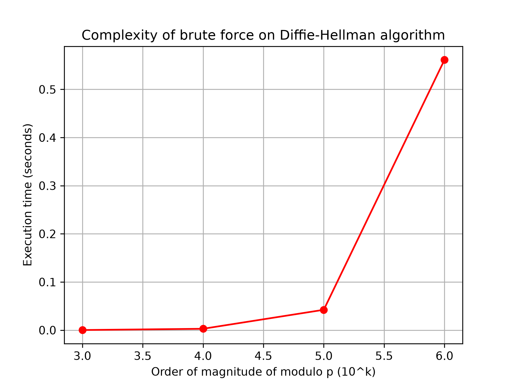
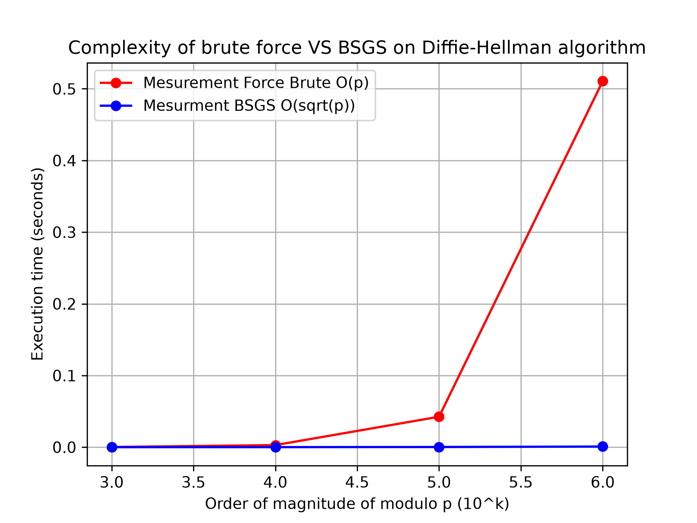

# Cryptanalysis of the Diffie-Hellman Key Exchange

To summarize, this project is a study and a benchmarking of the security of the Diffie-Hellman key exchange protocol.

To explain simply the mathematics behind the Diffie-Hellman protocol, its security is based on the difficulty of solving the **Discrete Logarithm Problem (DLP)** on finite fields.

This project explains different ways to bypass this problem, ranging from simple and naive methods to advanced Red Teaming techniques. In this repository, you will find the code implementation, the mathematical applications, as well as the analysis, explanations, and benchmarking of each solution.

This repository is organized around each solution: first, an explanation of the problem, followed by different solutions with their respective explanations and benchmarks.


## 1. The Problem

First, let's explain the problem from a mathematical perspective.

The Diffie-Hellman key exchange protocol provides a way to establish a shared secret key ($K$) between two people (Alice and Bob) who want to secure their communication over an insecure public network.

1. Alice and Bob agree on two public parameters:
   - A large prime number $p$.
   - A generator $g$ (a primitive root modulo $p$).
2. Alice chooses a secret private number $a$, and Bob chooses a secret private number $b$.
3. They compute their public values:
   $$A = g^a \pmod p$$
   $$B = g^b \pmod p$$
4. They exchange $A$ and $B$ over the public network.
5. Finally, they compute the shared secret key $K$:
   $$K_a = B^a \pmod p$$
   $$K_b = A^b \pmod p$$

They obtain the exact same key $K$ because:
$$K = K_a = (g^b)^a \equiv g^{a \cdot b} \equiv (g^a)^b = K_b \pmod p$$

Moreover, an eavesdropper (Eve) listening to the network knows $p$, $g$, $A$, and $B$. To recover the secret exponent $x$, Eve needs to solve the following equation:

$$g^x \equiv A \pmod p$$

This is the **Discrete Logarithm Problem (DLP)** over finite fields.


## 2. Solution 1: Naive Brute-Force Attack

The easiest and most naive way to solve this problem is to try every possible value of $x$ sequentially.

Below is the benchmark graph showing execution time as a function of the order of magnitude of $p$ (number of digits):



### Complexity Analysis:
- **With respect to $p$:** The time complexity is **linear** $\mathcal{O}(p)$.
- **With respect to key size (number of digits $k$ of $p$):** The time complexity is **exponential** $\mathcal{O}(10^k)$.

As shown on the graph, adding just a few digits to $p$ causes the execution time to explode. If $p$ is sufficiently large, a naive brute-force attack would take decades or centuries to find $x$.

## 3. Solution 2: Shanks' Baby-Step Giant-Step (BSGS) Algorithm

To optimize the naive brute-force approach, we can use **Shanks' Baby-Step Giant-Step (BSGS)** algorithm, a meet-in-the-middle technique that reduces the time complexity from linear $\mathcal{O}(p)$ to square-root $\mathcal{O}(\sqrt{p})$.

### Mathematical Principle

Instead of searching $x$ sequentially across the entire range $[0, p-1]$, we decompose $x$ using a spatial split:

Let $m = \lceil \sqrt{p} \rceil$. Any secret integer $x \in [0, p-1]$ can be uniquely written as:
$$x = i \cdot m - j \quad \text{where } 1 \le i \le m \text{ and } 0 \le j < m$$

*Example:* For $p = 23$, $m = \lceil \sqrt{23} \rceil = 5$. Any integer $x \in [0, 22]$ can be represented with $i \in [1, 5]$ and $j \in [0, 4]$.

Substituting $x = i \cdot m - j$ into the Discrete Logarithm equation $g^x \equiv A \pmod p$:

$$g^{i \cdot m - j} \equiv A \pmod p$$

Multiplying both sides by $g^j \pmod p$:

$$(g^m)^i \equiv A \cdot g^j \pmod p$$

### Algorithm Steps:
1. **Baby Steps (Precomputation):**
   Compute $A \cdot g^j \pmod p$ for all $j \in [0, m-1]$ and store the pairs $\{ (A \cdot g^j \pmod p) : j \}$ in a hash table (Python dictionary).
2. **Giant Steps (Search):**
   Compute $(g^m)^i \pmod p$ for $i \in [1, m]$. For each step, check if the value exists in the hash table.
3. **Collision Resolution:**
   When a match is found, we obtain the pair $(i, j)$ and immediately reconstruct the secret key:
   $$x = i \cdot m - j$$

### Complexity Analysis:
- **Time Complexity:** $\mathcal{O}(\sqrt{p})$ (at most $m$ Baby Steps and $m$ Giant Steps).
- **Space Complexity:** $\mathcal{O}(\sqrt{p})$ (required to store $m$ entries in the hash table).


## 4. Performance Benchmark & Comparison

Below is the comparative benchmark graph showing execution times for both algorithms up to $p \approx 10^6$:



### Benchmark Data Table:

| Modulo $p$ | Brute-Force Ops ($\mathcal{O}(p)$) | BSGS Ops ($\mathcal{O}(\sqrt{p})$) | Speedup Factor |
| :--- | :--- | :--- | :--- |
| $1\,009$ | $1\,008$ | $66$ | $\sim 15\times$ |
| $10\,007$ | $10\,006$ | $\approx 200$ | $\sim 50\times$ |
| $100\,003$ | $100\,002$ | $\approx 630$ | $\sim 150\times$ |
| $1\,000\,003$ | $1\,000\,002$ | $\approx 2\,000$ | $\sim 500\times$ |

**Conclusion:** BSGS drastically outperforms brute-force by replacing exponential operations with constant-time hash table lookups ($\mathcal{O}(1)$ average lookup).


## 5. Phase 2: Active Network Man-in-the-Middle (MitM) Attack

While Diffie-Hellman guarantees confidentiality against passive eavesdroppers (if $p$ is sufficiently large), it is fundamentally **vulnerable to active attacks** in the absence of authentication (such as SSL/TLS certificates).

To demonstrate this vulnerability, we implemented a real-time **Man-in-the-Middle (MitM)** attack over TCP/IP sockets involving three independent programs.

### Network Topology & Port Mapping:

```text
  [ Alice Client ]  <--- (Port 65432) --->  [ Eve MitM Proxy ]
                                                    |
                                               (Port 65433)
                                                    v
                                             [ Bob Server ]
```

Attack Mechanism (eve.py):

**Socket Interception:** Eve listens on port 65432 (pretending to be Bob) and connects to Bob on port 65433 (pretending to be Alice).

**Key Substitution (Poisoning):**

- Alice computes her public key $A = g^a \pmod p$.
- Bob computes his public key $B = g^b \pmod p$.
- Eve intercepts both keys and generates her own secret $e$ and public key $E = g^e \pmod p$.
- Eve sends $E$ to Alice (instead of $B$) and $E$ to Bob (instead of $A$).

**Secret Derivation:**

- Alice computes $K_{\text{Alice}} = E^a \pmod p$.
- Bob computes $K_{\text{Bob}} = E^b \pmod p$.
- Eve derives BOTH shared secrets:
  $$K_{\text{Eve-Alice}} = A^e \pmod p = K_{\text{Alice}}$$
  $$K_{\text{Eve-Bob}} = B^e \pmod p = K_{\text{Bob}}$$

**On-the-Fly Decryption & Message Tampering:**

When Alice sends an encrypted message over the network:

1. Alice encrypts "ENVOYER 100 EUROS" using $K_{\text{Alice}}$ and transmits the payload.
2. Eve intercepts the socket bytes, decrypts the payload with $K_{\text{Alice}}$, and reads the plaintext.
3. Eve alters the message to "ENVOYER 10000 EUROS".
4. Eve re-encrypts the tampered message using $K_{\text{Bob}}$ and forwards it to Bob.
5. Bob receives and decrypts the payload with $K_{\text{Bob}}$, unaware that the message was modified.
